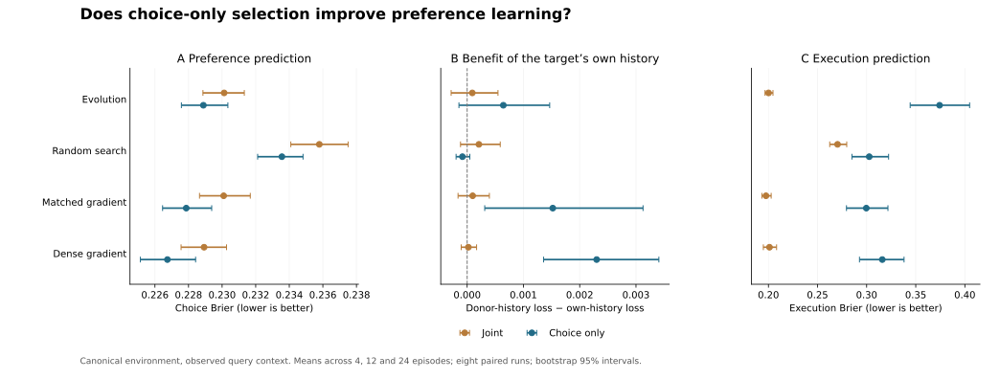

# Joint versus choice-only pressure: completed results

**Choice-only training improved preference forecasts, but the evolved learner did not meet the full primary acquisition criterion.** Both gradient-trained controls showed clearer benefits from using the particular target's history. Removing execution from the objective also substantially degraded execution prediction. The result supports an effect of the objective on acquisition; it does not establish that evolutionary selection reliably recovered both learning functions.

All eight paired runs completed on the first launch: two objectives × four methods × eight replicates = 64 procedures. Eight scientific tests and repository CI passed before launch. No API calls; API cost $0. All original study sources and earlier results are unchanged.

[Prospective protocol](https://github.com/msblanders/wtr-bench/blob/1b95143516ff32fd25b0201249ea13fee82dd58a/experiments/choice-objective-v1/README.md) · [Study run](https://github.com/msblanders/wtr-bench/actions/runs/41035176371) · [Draft PR #18](https://github.com/msblanders/wtr-bench/pull/18) · [Aggregate metrics](summary.json) · [Replicate index](results-index.json)

## Primary outcome

The primary test uses new targets in the original habitat mixture and queries a context in which each target was already observed. Scores average equally across 4,12,24 history episodes. All intervals bootstrap eight paired whole selection/training runs, 10,000 resamples. Positive differences are favorable.

| Required result for evolution | Brier improvement | Paired 95% interval | Favorable runs | Decision |
|---|---:|---:|---:|---|
| Choice-only beats joint training | +.001236 | [.000720, .001778] | 8/8 | Passed |
| Choice-only intact history beats zero memory | +.000474 | [−.000202, .001194] | 5/8 | Inconclusive |
| Choice-only own history beats donor history | +.000643 | [−.000146, .001466] | 6/8 | Inconclusive |

All three were required. The conjunction therefore failed. This is not evidence that the true history effects are exactly zero; the small positive point estimates remain uncertain. Nor should the first criterion be described as proof of target-specific learning: it can partly reflect better payoff-to-choice calibration.

Source choice Brier fell from .230121 to .228885 for evolution, a 0.54% reduction in total Brier. Both arms used the same choice-focused development judge and the same training observations, initializations and budget. Thus the effect cannot be attributed simply to selecting final models with different development metrics. The joint arm was retrained under this common judge; the preceding study's joint models were not reused.

All three panels concern the primary canonical observed-context suite. Lower is better in A and C; positive means the target's own history helps in B. Error bars bootstrap entire runs. A and C show intervals for group means; the primary objective comparison uses paired differences in the table above.

## What the gradient controls add

These were prespecified secondary comparisons. All gradient models retain the same architecture, observation interface and training budget between objectives; only the execution loss term is removed. The small gradient model is architecturally identical to the evolved learner. The dense model has more parameters and memory.

| Method | Choice improvement from choice-only training | Its zero-memory comparison | Its donor-history comparison |
|---|---:|---:|---:|
| Evolution | +.001236 [.000720,.001778] | +.000474 [−.000202,.001194] | +.000643 [−.000146,.001466] |
| Matched gradient | +.002230 [.001656,.002828] | +.001139 [.000530,.001899] | +.001521 [.000312,.003125] |
| Dense gradient | +.002183 [.001320,.003128] | +.002037 [.001246,.002924] | +.002301 [.001359,.003406] |

Both gradient controls give evidence of useful target-specific history use under choice-only training. This makes “the architecture cannot use choice histories at all” too strong. It is compatible with the joint objective making preference acquisition harder, while evolutionary search adds a further limitation under the tested budget. It does not isolate gradient conflict, representational bottlenecks, search variance or the amount of optimization needed.

The donor-benefit interaction—choice-only history benefit minus joint history benefit—is +.000551 [−.000155,.001183] for evolution, +.001424 [.000256,.003005] for matched gradient, and +.002280 [.001250,.003449] for dense gradient. Thus the gradient result involves more than a static calibration improvement. It is still an exploratory family of secondary comparisons, not a replacement for the failed primary conjunction.

The supplied functional reference's source choice Brier is .221891. There remains room to improve; the small neural gains should not be presented as complete acquisition of the reference update rule. The reference sees complete menus and has a useful generative form supplied, so it is a privileged benchmark rather than an equal-information competitor.

## The cost of dropping the other task

| Method | Choice: joint | Choice: choice-only | Execution: joint | Execution: choice-only |
|---|---:|---:|---:|---:|
| Evolution | .230121 | .228885 | .200144 | .374258 |
| Random search | .235789 | .233561 | .270383 | .302651 |
| Matched gradient | .230094 | .227863 | .197509 | .299653 |
| Dense gradient | .228926 | .226743 | .201085 | .315935 |

These are source-context observed-outcome Brier scores; lower is better. Execution is still queried and scored, but receives no training reward in the choice-only arm. Its deterioration is an observed tradeoff under this intervention, not proof that the tasks inherently cannot coexist. The manipulation identifies a potential bottleneck; it is not a proposed solution for an agent that needs to learn both problems.

## Transfer results, kept secondary

The canonical held-out-context view reuses the same targets, histories, payoffs and future outcome draws as the primary view; only the query context changes. For the choice-only evolved learner, memory benefit is +.001392 [.000359,.002570] and own-history advantage over donors is +.001276 [.000516,.002105]. These favorable secondary estimates are worth retaining, but they do not override the uncertain effects in the prespecified primary context. They suggest small, context-sensitive history effects rather than a robust primary success. Donor permutations differ between the views, as specified in advance.

Under the new payoff/assignment distribution, evolved choice-only improvements and both history benefits remain inconclusive. The matched gradient learner shows a small positive own-versus-donor effect; dense-gradient gains under this shift are not reliable. Exact estimates for every method/suite are in `summary.json`.

The external games were already examined in the preceding study and informed this follow-up. Results below are secondary iterative development on fresh draws from a known benchmark—not a fresh untouched confirmatory test.

| Method | External choice Brier, joint | External choice Brier, choice-only | Choice-only benefit over zero memory | Choice-only benefit over donor history |
|---|---:|---:|---:|---:|
| Evolution | .323271 | .322635 | +.004873 [−.000704,.010713] | +.006544 [.000996,.012674] |
| Matched gradient | .322252 | .314615 | +.009793 [.003710,.017563] | +.010454 [.003810,.018926] |
| Dense gradient | .324071 | .300738 | +.026067 [.017796,.034089] | +.023106 [.015793,.030465] |

The dense learner's external choice error improves by about **7.2%** under choice-only training. Its objective improvement and both history-control improvements are positive in all eight runs. The matched learner also improves, though less. Evolution shows a positive donor-history effect in 7/8 runs, but its zero-memory advantage and objective improvement remain uncertain. Do not reduce this to “evolution learned nothing,” and do not present it as a clean evolutionary transfer success either.

The supplied reference scores .233024 externally, substantially better than every learned model. This test uses the independently authored Game Generator and built-in selfish/altruistic actors, with varying menu size and payoffs. It remains two-player prediction with static actors, not the full Bayesian Reciprocator, adaptive strategic interaction, human behavior, or several qualitatively different knowledge domains. Source/adapter provenance and exact restrictions remain in the frozen protocol.

## Evidence updates and selection diagnostics

The average choice response to voluntary failure versus refusal in an observed context increases from +.001036 to +.012996 for evolution when training becomes choice-only. Corresponding choice-only shifts are +.019679 for matched gradient and +.022555 for dense gradient. The supplied reference shifts +.115572. Choice updates are moving in the expected direction, but remain much smaller than the reference.

For refusal versus no new evidence, choice-only average choice shifts are −.012201 (evolution), −.013648 (matched gradient) and −.018023 (dense gradient), compared with reference −.070135. Full two-channel diagnostics for seen and held-out contexts are retained. Unrewarded execution outputs can move in arbitrary or incorrect directions; they are not evidence of preserved execution learning. No internal state is assigned an IRV interpretation.

Final evolution champions were selected at generations `[509,499,262,482,424,509,450,504]` under joint training and `[501,510,403,55,464,443,417,456]` under choice-only training. A single early champion therefore exists; most runs were selected much later. All checkpoint ages are reported rather than selecting the best replicate after the fact.

The secondary, unselected generation-512 procedures give the same broad ordering in the 24-episode source cell: choice-only own-versus-donor gains average .000179 for evolution, .002101 for matched gradient, and .003842 for dense gradient. These are single-cell descriptive means, not the primary three-length estimates. The full raw-final scores are retained so checkpoint selection can be examined directly.

## Implication for the next test

This test provides evidence that the objective affects acquisition, particularly for gradient learners. It leaves unresolved why evolutionary search gives only weak/inconsistent preference-history benefits and how to acquire both useful functions together.

The next useful intervention is to **restore the joint objective and test how memory interacts with option payoffs in the readout**, with a parameter-matched comparison. A generic interaction between every state coordinate and payoff features would address the concrete softmax-cancellation issue without assigning a willingness variable or supplying cue-routing rules. The comparison must retain execution performance as a required outcome; removing the execution task again would not answer the portfolio question. This is a proposed next experiment, not an additional run launched after inspecting the results.

The current evidence does not establish evolved functional modularity, literal WTR representation recovery, or a broad theory of AI development. It is a controlled diagnostic result about learning pressure, search and readout in a small model family.

## Preservation and verification

- Frozen protocol/source commit: `1b95143516ff32fd25b0201249ea13fee82dd58a`.
- Same-tree guarded launch: `0526d1ae00afc7e63eb6fb180dd8ac603734b650`; study run `41035176371`, first attempt, all jobs successful.
- Prelaunch validation `41034970446`: eight scientific tests passed. Repository CI `41034970170` passed.
- Model, world, external-adapter and dependency files are byte-identical to the preceding study. All frozen hashes were checked again after outcomes; none changed.
- Per replicate, all eight procedures received identical training and development arrays/targets; hashes match. Each arm/method had 32,768 distinct training lifetimes. Each search method evaluated 16,384 candidates; gradient learners performed 512 updates. Cross-method computation is not matched.
- All 96 prespecified paired contrasts and bootstrap intervals were independently recalculated from the saved per-run metrics and matched the frozen aggregate. See `verification.json` and the post-run `analyze_saved.py`.
- Mean per-replicate selection/training/evaluation time: 42.18 seconds, excluding Actions setup and dependency installation. No API cost.
- `results-index.json` lists eight complete replicate records and all 64 final selected procedures as readable parameter arrays, with parameter counts verified (257 or 1969) and a tested reconstruction path.
- `manifest.json` records source/runtime hashes and upstream provenance; `artifacts.json` records checkpoint and frozen-source artifact IDs/digests. The Actions copies currently expire January 28, 2027, Pacific time. The repository retains the report, metrics, figure and final selected parameters.
- Public publication initially paused after automatic approval review required explicit authorization for results and parameters. The user explicitly authorized both on October 30, 2026. This publication preserves the original run; no experiment was repeated. The earlier private bundle remains a historical snapshot of the report before publication authorization.
- The numeric-budget configuration hash is the same as the predecessor because the numerical budget is unchanged. Version, frozen executable/protocol hashes, objective metadata and run/commit IDs distinguish the studies; configuration hash alone is not a unique study identifier.
- Plotting and this interpretation are post-run additions. No extra outcome-based run, architecture adjustment, budget increase or hypothesis substitution was made in the reported experiment.
