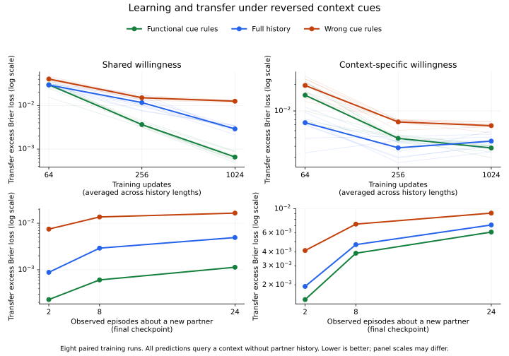

# Learned cue transfer: results and limits

**48 models completed across eight paired training runs, with $0 API usage.** The prespecified primary comparison favored supplied functional cue rules in the shared-trait world under reversed context cues. The boundary test exposed continuing problems with inappropriate transfer in both learners.

## Primary finding

The functional learner had **22.45% lower average transfer error** than the more generously parameterized full-history learner on the prespecified measure. The paired difference, history minus functional, was **+0.003306** excess Brier loss, with exploratory bootstrap 95% interval **[+0.000966, +0.006018]**. Seven of eight complete replicate differences favored the functional learner.

This score averages willingness and ability predictions for a context with no history for that partner, across exposure prefixes 2, 8 and 24, and trained checkpoints 64, 256 and 1024. It is not the final checkpoint alone, an independent-observation test, or an exact continuous learning-curve integral.

| Learner | Primary curve-average error | Final reversed-cue error | Reached .002 criterion |
|---|---:|---:|---:|
| functional | 0.011421 | 0.000657 | 8/8 |
| history | 0.014727 | 0.002910 | 0/8 |
| wrong_rules | 0.022707 | 0.012547 | 0/8 |

All eight functional models first reached the prespecified criterion at the final tested checkpoint, 1024 updates. The other models were right-censored at the end of training. We cannot estimate how much additional training they would require or claim an exact training-speed ratio.

The final-checkpoint functional error was 77.43% lower than full history (secondary comparison). The error gap remained after the allotted training budget; it was not tested to convergence.

Top panels average across history prefixes; faint lines are individual training replicates. Bottom panels show the final models as history accumulates for new partners. Axes use logarithmic error scales, with ranges that can differ between panels. An increase with history here means greater discrepancy from the progressively informed Bayesian reference, not necessarily increasing absolute error against the latent trait.

## What the learned behavior shows

The update network was trained from future observed behavior. It was not supplied latent traits, posterior labels, Beta counts or fixed numerical update equations. The functional rule selected eligible evidence; its numerical update function was learned.

On matched histories in the shared ecology, replacing a refusal with a voluntary failed attempt should raise inferred willingness and lower inferred ability. The mean predicted changes were:

| Learner/reference | Willingness change | Ability change |
|---|---:|---:|
| Exact reference | +0.155218 | −0.058788 |
| Functional cue rules | +0.148929 | −0.051844 |
| Full history | +0.129615 | −0.050382 |
| Wrong rules | +0.100912 | 0.000000 |

The full-history learner got **99.93% of the informative change directions correct** for this diagnostic. This is evidence that it learned the basic behavioral distinction; the primary error difference cannot be described as generic learning being unable to distinguish inability from unwillingness. These are secondary descriptive diagnostic results, not independent replications or mechanism identification.

The functional learner had exact zero changes in channels excluded by its masks, as guaranteed by construction. The full-history learner showed small unintended changes: for example, changing an assigned failure to an assigned success changed its willingness prediction by an average absolute **0.00853**, where the reference change was zero. Such residual changes and calibration differences can matter under changed cue frequencies.

The wrong-rules control treated both a refusal and a failed attempt as an undelivered outcome in its ability stream, so it could not distinguish them there. Its poorer performance validates this deliberate loss of relevant information; it is not an independent test of a verbal psychological theory.

## All environments and stress suites

The table reports the same average across trained checkpoints and history prefixes. Lower is better; secondary suites do not replace the primary comparison.

| Regime | Learner | Canonical | Reversed | Assigned only | Voluntary only |
|---|---|---:|---:|---:|---:|
| shared | functional | 0.011414 | 0.011421 | 0.006402 | 0.012220 |
| shared | history | 0.011156 | 0.014727 | 0.016669 | 0.017277 |
| shared | wrong_rules | 0.022733 | 0.022707 | 0.030195 | 0.035329 |
| context_specific | functional | 0.007969 | 0.007932 | 0.006248 | 0.007489 |
| context_specific | history | 0.004300 | 0.005266 | 0.004012 | 0.009031 |
| context_specific | wrong_rules | 0.011257 | 0.011247 | 0.012785 | 0.018703 |

In the shared ecology, the original-frequency average was similar for functional and history learners: 0.011414 versus 0.011156. Under reversed frequencies it became 0.011421 versus 0.014727. This descriptive comparison suggests the supplied invariance helped when contextual correlations shifted. A formal shift-penalty contrast was not the prespecified primary estimand.

## Boundary finding: do not overstate the reversal

With independently context-specific willingness, the full-history learner had lower error on the across-checkpoint reversed-cue measure: **0.005266 versus 0.007932**. The paired history-minus-functional interval was **[−0.003825, −0.001476]**. The prespecified secondary difference between ecologies was +0.005972, interval [+0.003297, +0.008900]. These secondary intervals are exploratory and uncorrected for multiplicity.

However, the final checkpoint favored the functional learner in overall error: **0.003825 versus 0.004573**. The early boundary advantage did not persist. It is therefore misleading to say the generic learner successfully learned the correct local organization and consistently defeated pooling.

Both models continued to transfer willingness evidence inappropriately into a context where that partner had never been observed. In the boundary diagnostic, failure-versus-refusal evidence from another context should change heldout willingness by zero. The functional learner changed it by +0.061118 on average; full history changed it by +0.053746. Likewise, final heldout-willingness excess errors were 0.006734 and 0.007640. Both violate the boundary's required locality.

At the early checkpoint the history learner's heldout willingness was closer to the uninformative .5 prior; later training increased that channel's error. Better early overall prediction therefore cannot be taken as evidence of learned context-specific causal organization. Ability improvements and willingness transfer errors must be considered separately.

## Interpretation for the research program

This is conditional evidence for an engineering benefit of **supplied evidence-eligibility and transfer assumptions** in a world satisfying those assumptions. The useful observations are the gap size, its persistence within the budget, the learned calibration, robustness across cue schedules, and explicit failures outside the pooling assumption.

The functional model itself uses one shared recurrent network for both state banks. These results concern which evidence updates each estimate, not whether different physical update networks are necessary. The full-history model also learned the basic dissociation behaviorally; its internal mechanism has not been recovered.

The functional and wrong-rules learners each have 330 parameters, and full history has 1506; all have 16 persistent state values. Data and optimizer-step budgets match. The designs do not match every compute or representational property. In particular, the full-history learner must learn context invariance that the functional architecture receives in advance.

This synthetic world retains equations from the earlier social pilot and was specified to instantiate the functional assumptions. It cannot establish that those assumptions are independently novel, uniquely correct, selected by evolution or broadly useful across knowledge domains. Willingness probability also remains distinct from an identified welfare-tradeoff ratio.

The next stronger extension would test discovery of evidence routing without supplying the masks, and eventual transfer to an independently specified environment. This completed study supplies a frozen comparator and explicit failure signatures for that work.

## Integrity and reproducibility

- [Study run 41021562584](https://github.com/msblanders/wtr-bench/actions/runs/41021562584): validation, all eight training jobs and aggregation succeeded on the first study attempt.
- Frozen source/protocol commit: `553299e7517278bfc48f52b6b7910f49dca36819`.
- Launch commit: `984e5b07cedef02d59713b3dcb7ff35223ac0883`.
- Config SHA-256: `4b2f70414864cace64da05e7fbeb0a03d95f859f5096916d9efef1ee4649cee3`.
- Nine development tests passed, including agreement with the earlier independent scalar estimator, causal input checks, masks, parameter accounting and actual learned-weight changes. Main repository CI also passed before launch completion.
- All three models within each regime and replicate had matching hashes of training histories, lengths and future targets. Each training record contains all 16 scheduled loss logs ending at update 1024 and all four checkpoints.
- All six models within a replicate completed before its evaluation data were generated. Evaluation and diagnostic seeds were separate from training and development.
- Full results were recovered from completed job logs and checked for all eight replicates, both regimes and all three models. Every suite mean was independently recomputed against the frozen aggregate.
- The eight complete training runs are the replication units. The bootstrap resamples those runs, not individual predictions.
- Source, cue specification and protocol were unchanged after outcomes. Diagnostic averaging and plotting in this results commit are presentation steps; primary and secondary estimands remain as frozen.
- All checkpoint weights remain in the eight seed artifacts. Artifact IDs, digests and January 27, 2027 (Pacific) expiry are recorded in artifacts.json. Numeric results and source are preserved in this repository.

Files: [frozen protocol](../../README.md), [cue specification](../../cue-spec.md), [summary](summary.json), [every replicate](replicate-results.json), [diagnostic means](diagnostics.json), [manifest](manifest.json), [artifact metadata](artifacts.json). Plotting used Matplotlib 3.10.8; the plotting script is separate from the frozen training/scoring source.
