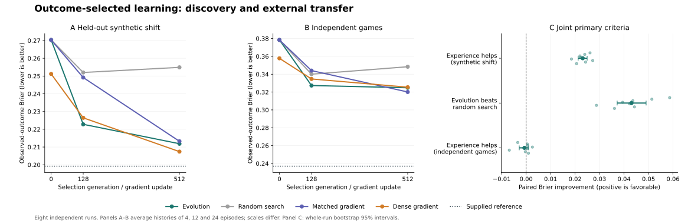

# Outcome-driven discovery and independent-game transfer: results

**The joint success criterion failed.** Evolution discovered useful execution-outcome updating without supplied cue-routing rules, and beat equal-budget random search. It did not establish useful social-preference learning: memory slightly worsened choice predictions in the source environment and gave no reliable benefit in the independent games. This is partial acquisition, not successful recovery of the full proposed functional organization.

All eight independent runs completed on the first launch. Thirty-two selected/trained procedures were evaluated: evolution, random search, matched-architecture gradient training, and a larger shared-history GRU in each run. Ten scientific integrity tests and repository CI passed. No API calls; API cost $0. The original protocol and study code were not changed after outcomes were observed.

[Frozen protocol](../../README.md) · [Study run](https://github.com/msblanders/wtr-bench/actions/runs/41031406355) · [Draft PR #17](https://github.com/msblanders/wtr-bench/pull/17) · [Aggregate JSON](summary.json) · [All replicate metrics](replicate-results.json)

## Prespecified primary result

Positive values favor the evolved procedure. Intervals bootstrap eight whole paired runs, 10,000 resamples. Primary scores average equally across 4, 12 and 24 history episodes. The synthetic score equally weights choice and execution; the external score concerns choice only.

| Joint requirement | Mean Brier improvement | Paired 95% interval | Result |
|---|---:|---:|---|
| Useful evolved memory under synthetic shift | +.023117 | [.021269, .024924] | Passed; 8/8 positive |
| Evolution beats equal-budget random search under shift | +.043035 | [.037186, .049006] | Passed; 8/8 positive |
| Useful evolved memory in independent games | −.000695 | [−.002811, .001015] | Failed; 5/8 positive |

All three were required. The first two cannot compensate for the third. The external estimate does not establish harm either: its interval includes zero.

Panels A–B report development-selected checkpoints, with separate vertical scales; population generations and gradient updates are not equal computation. The dotted supplied reference knows a useful generative form and sees complete menus, so it is a privileged benchmark. Panel C shows all eight replicate contrasts and run-level intervals.

## What selection actually learned

The synthetic combined score concealed a large difference between the two prediction problems. The following channel decomposition was specified as secondary; its bootstrap contrasts were calculated after the primary aggregate and are exploratory.

| Evolved learner, shifted world | Intact memory Brier | Memory held at zero | Benefit from memory, 95% interval |
|---|---:|---:|---:|
| Future voluntary choice | .221321 | .219073 | −.002248 [−.003882, −.000841] |
| Future execution success | .202394 | .250875 | +.048482 [.043928, .052636] |

The same pattern appears in the canonical development-distribution test: execution memory gain +.054543 [.052396, .056191], choice memory gain −.001320 [−.001941, −.000740]. Choice predictions worsened with memory in all eight canonical runs. Thus the external failure cannot be isolated as a transfer failure of an already-acquired preference-learning rule. That source capability was not demonstrated first.

Post-selection evidence interventions reinforce this interpretation. Entries below are average changes in the predicted probability, after appending evidence in an observed context and querying a held-out context. The supplied reference has the stationary, independent shared-trait assumptions used in development.

| Evidence contrast | Evolved choice shift | Reference choice shift | Evolved execution shift | Reference execution shift |
|---|---:|---:|---:|---:|
| Voluntary failure versus refusal | +.000911 | +.114380 | −.059842 | −.065677 |
| Assigned success versus assigned failure | −.000509 | 0 | +.131168 | +.131238 |
| Refusal versus no new episode | −.000071 | −.069351 | −.002666 | 0 |

The execution update is substantial and roughly aligned with the supplied reference. The preference response is nearly absent. **Tiny changes on theoretically irrelevant choice channels do not establish selective cue use when the theoretically relevant choice channel also barely changes.** The magnitude comparisons are more informative here than pooled directional accuracy.

Individual state-coordinate lesions are included in every replicate's metrics. Coordinate identities were not aligned across runs and no state is assigned a psychological name. Lesions often impair execution and do not establish a common preference variable. They are implementation-specific, potentially off-manifold interventions, not causal-abstraction recovery.

## Comparators and all environments

Final observed-outcome Brier scores, lower is better. Comparisons are within rows; external choice scores use variable action counts and should not be compared numerically with the two-channel synthetic scores.

| Environment | Evolution | Random search | Matched gradient | Dense gradient | Supplied reference |
|---|---:|---:|---:|---:|---:|
| Canonical | .213909 | .243648 | .213433 | .212448 | .205925 |
| Shifted | .211857 | .254892 | .213235 | .207415 | .199215 |
| Context-local preferences | .213347 | .243719 | .213132 | .211779 | .211599 |
| Correlated traits | .213198 | .243120 | .211920 | .211371 | .205447 |
| Preference reversal | .214447 | .244251 | .214097 | .212953 | .212064 |
| Independent games, choice only | .324820 | .348391 | .320104 | .325440 | .236976 |

Evolution's external score beats random search by .023571 [.017477, .030149], but this **does not show that its acquired memory procedure transfers**: holding its memory at zero gives .324125, essentially the same performance. Improved payoff-to-choice calibration can explain an aggregate advantage without target-specific learning from history.

The matched small gradient learner shows a modest external memory benefit, +.004190 [.001508, .008018], positive in 7/8 runs. This is exploratory and far smaller than the gap to the supplied reference. The larger dense learner's corresponding benefit is +.000569 [−.000461, .001525], inconclusive. All three trained neural procedures have weak source-world preference acquisition under this budget, so the result is not clean evidence that evolutionary selection alone caused the difficulty. Nor does the matched-gradient result support saying the four-state architecture is categorically incapable of using external choice histories.

The boundary scores do not demonstrate that selection discovered when to change its rules. Each procedure was selected in the original habitat mixture, then frozen. Ability learning remains useful across the boundary suites, and weak preference learning makes their aggregate scores relatively insensitive to the preference changes. A separate ecology-of-selection manipulation is needed to test ecological differentiation of update rules.

## Scope of the independent test

The external menus and choice likelihoods came from unchanged, checksum-verified definitions in `maxkw/evolution`, commit `8d7f9946b3cc4ff1d7fae7a1a7a149499c35dede`. The adapter used the original Game Generator, SelfishAgent and AltruisticAgent, two players, variable option counts, Poisson costs, exponential benefit increments and .02 tremble. No generated option was truncated. Every external history and outcome was generated after all four methods in the replicate finished training.

This is independent implementation transfer, not empirical validation. It does not cover the full Bayesian Reciprocator, adaptive strategic opponents, humans, or several qualitatively different knowledge domains. The social utility family overlaps development. Input feature engineering and query meanings are supplied. Four states, a gated-update family and a readout architecture are also supplied; selection discovered parameterized procedures within that family, not a learning architecture from arbitrary programs.

The task has substantial exploitable preference information: the supplied reference reaches .236976 externally versus the evolved learner's .324820. That reference is not a fair equal-information/resource competitor—it sees complete menus and has a useful rule supplied—but it is useful evidence against interpreting the weak neural results as absence of any learnable signal.

## What this changes about the next experiment

The immediate unresolved question is acquisition: why did both search and gradient training mainly learn execution while barely using choice histories? An explanation worth testing is unequal pressure from the joint objective: execution learning gives larger or easier gains, so it dominates the allotted optimization budget. This is a hypothesis, not established by the current result.

There is also a concrete representational possibility. A useful choice readout must learn interactions between target memory and option payoffs. In the linear limit of the shared score network, a state-dependent additive term is the same for every option and cancels in the softmax. The nonlinear network can represent the needed interactions, but execution prediction can benefit from a direct state-dependent shift much more readily. Calling the architecture generic does not make these two learning problems equally easy. The current experiment does not separate this readout issue from objective competition or insufficient optimization.

A focused follow-up should compare **joint versus choice-only selection/training**, holding the observation interface, generic architecture and candidate budget fixed, with new run seeds and a prospectively specified source-choice acquisition criterion. If choice-only pressure produces useful preference updating, that supports an objective-competition explanation. If it does not, investigate optimization budget and representation before claiming an external generalization limit. This changes the selective environment without inserting the desired rule. The external benchmark is now a known development target; repeated adaptation against its results must be described as iterative development rather than a fresh untouched confirmatory test.

No extra run was launched after examining these outcomes. The reported null is retained.

## Provenance and verification

- Frozen source/protocol commit: `84327623135941b17f77632ac23f9ba7267dd47f`.
- Same-tree launch commit: `19922365aa38de6a762e1423bcf54eef71721abb`.
- Configuration SHA-256: `cbe2f65903fcb6c9dbbd29b46603be44da3c7b7443116374f613dfcd40ecfe89`.
- Run: `41031406355`, first attempt, all jobs successful. Prelaunch validation run `41031223025` passed ten scientific tests; repository CI `41031222582` passed.
- Each method received the same 32,768 distinct training lifetimes per replicate; training-input/target hashes match across all four methods in every run. Search evaluated 16,384 candidates per method per replicate; gradient methods performed 512 updates. They do not have equal compute budgets.
- Mean per-replicate selection, gradient training and evaluation time was 30.31 seconds, excluding Actions setup and dependency installation. Eight selection/training runs are the inferential units, not the hundreds of thousands of evaluation predictions.
- All 24 prespecified paired contrasts and their 10,000-resample intervals were independently recomputed from recovered per-run metrics and matched the frozen aggregation output.
- `manifest.json` contains exact source/runtime hashes; `artifacts.json` contains checkpoint/frozen-source artifact IDs, digests and retention metadata. Checkpoint artifacts currently expire January 28, 2027, Pacific time. Source, seeds and metrics are retained in the repository for reproduction.
- `plot_results.py` and `secondary-channel-analysis.json` are post-run presentation/analysis additions; they do not change selected models, frozen scoring or the primary decision rule.
