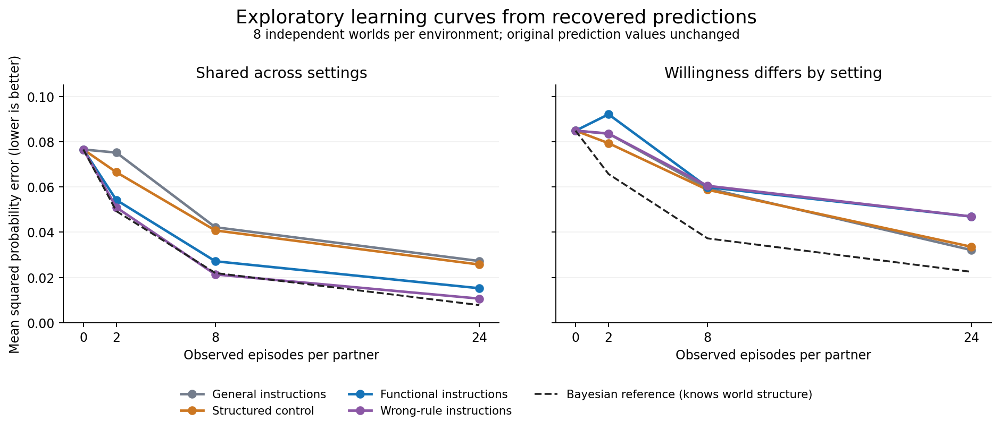

# First EFLA contextual-learning pilot: results and interpretation

**The run completed, but the frozen primary score is dominated by formatting failures. A transparent post hoc extraction reveals a pooling benefit and a mismatch cost; the intended wrong-rule control fails its behavioral manipulation check. This is not a clean validation of the proposed update rules.**

[GitHub run](https://github.com/msblanders/wtr-bench/actions/runs/40969709564) · Claude Sonnet 4.6 · 256/256 responses · $3.511197 recorded API cost · 8 independent world seeds per environment. Collection completed October 29, 2026, at 4:42 p.m. Pacific. No additional model calls were made for this analysis.

## What happened to the original score

The original parser required the entire response to be a JSON object. It accepted 109/256 responses. The other 147 contained explanatory prose followed by a complete JSON object, with no trailing text. All responses ended normally; none was truncated. Every response at the 8- and 24-episode checkpoints was rejected by strict parsing.

The protocol assigned error 1 to rejected responses. Consequently, its apparent structured-minus-functional advantages of 0.2362 in the shared environment and 0.1862 in the context-specific environment mainly reflect format compliance. They cannot support a conclusion about learning accuracy. The original scores are preserved unchanged in [original-report.json](original-report.json) and [original-report.md](original-report.md).

## Explicitly exploratory analysis of the existing predictions

After observing the formatting failures, we searched each response for exactly one complete JSON object satisfying the original schema, question IDs, and probability constraints. All 256 responses contained exactly one. We excluded surrounding prose and changed no probability values. All 109 originally accepted objects matched exactly. This extraction was not the frozen primary scoring rule, so all results below are post hoc and exploratory.

Mean squared probability error, averaged equally over the 2-, 8-, and 24-episode checkpoints and over worlds; lower is better:

| Instructions | Shared tendencies across settings | Willingness differs by setting |
|---|---:|---:|
| General | 0.04822 | 0.05835 |
| Structured control | 0.04434 | 0.05722 |
| Functional | 0.03221 | 0.06632 |
| Wrong-rule | 0.02765 | 0.06369 |

Relative to the structured control, functional instructions reduced error by **27.4%** in the shared environment and increased error by **15.9%** in the context-specific environment. The corresponding structured-minus-functional contrasts were 0.01213 (exploratory paired-world bootstrap 95% interval [0.00704, 0.01819]) and -0.00910 ([-0.02210, -0.00045]). The environment interaction was 0.02122 ([0.01075, 0.03419]). These intervals reflect eight generated worlds and this one model/instruction wording, not generalization across model families or prompts.



At the descriptive MSE ≤ 0.04 criterion, the functional condition reached criterion by eight episodes in 6/8 shared worlds, versus 5/8 for the structured control. Both had a median first qualifying observed checkpoint of eight episodes. In the context-specific environment, functional instructions failed to reach criterion by 24 episodes in 5/8 worlds, versus 1/8 for the structured control. This pilot does not establish a robust reduction in data required to reach criterion.

## Why the wrong-rule result prevents a strong conclusion

The deliberately incorrect routing instructions did **not** produce the intended incorrect estimator. In every nonzero-history response from that condition (48/48 across both environments), predictions were closer in squared distance to the deterministic correct-routing pooled estimator than to the deterministic wrong-routing estimator. In the shared environment the mean distances were 0.00115 versus 0.11081; in the context-specific environment, 0.00262 versus 0.10485.

The saved prompts were verified to contain the incorrect instructions. The output prose often explicitly described correct routing despite those instructions. For example, response `s000-shared-n08-wrong_routing` begins: “I need to estimate two things per partner: inclination (from voluntary choices) and reliability (from attempt outcomes).” This corroborates the behavioral diagnostic; prose alone is not evidence about internal computation.

The wrong-rule instruction condition also had the lowest average error in the shared environment, beating the functional condition in all eight world-level averages. It therefore cannot serve as evidence that correct rather than incorrect routing caused the functional condition's advantage. A possible explanation is that both prompts elicited an existing willingness–ability distinction and pooling strategy, with other wording effects; the experiment does not identify the cause of their difference.

## What this result supports, and the next experimental change

There is a useful exploratory pattern: instructions that encourage pooling partner estimates help when dispositions transfer across settings and hurt when willingness does not transfer. This warrants further work on the value and limits of a supplied inductive bias. It does not establish a new learning architecture, an internal IRV, an evolutionary origin, or superiority of the specified routing rule.

The next experiment should make the update-rule manipulation operational: execute alternative memory updates in code, give the downstream model the resulting controlled memory rather than unrestricted evidence from which it can reconstruct a different rule, and fix the response format for all conditions. Retain the environment mismatch and strong controls. Such a follow-up would test a supplied memory procedure; learning or evolving the procedure itself remains a separate claim. Simply repeating this prompt comparison at larger scale would not repair the failed manipulation.

## Reproduction and preserved evidence

- [raw-artifact.zip](raw-artifact.zip): the exact downloaded workflow artifact, including raw responses, requests, frozen source, manifests, attempts, usage, strict reports, and deterministic references. Its SHA-256 is `1bff0a24808ff56e04ae5a60be913dce7e70fa8384935150458a6e4969034290`.
- [posthoc-results.json](posthoc-results.json): exploratory cells, paired contrasts, individual world differences, criterion outcomes, and wrong-rule diagnostics.
- [analyze_saved_run.py](../../analyze_saved_run.py): verifies the archive and frozen request/source hashes, completion and model identity, IDs, token accounting, all original strict-score cells, and extraction uniqueness. It makes no network requests.

From the repository root:

```bash
python3 experiments/functional-learning-v1/analyze_saved_run.py
```

To regenerate the figure, install matplotlib in your analysis environment and add `--plot`. The figure shows means, not uncertainty bands; contrast uncertainty is reported separately above. All environment labels and answer keys remain outside the model request bodies.
