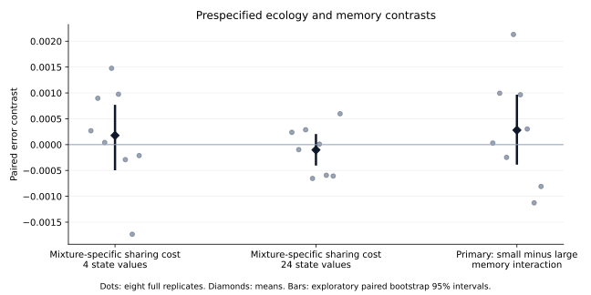
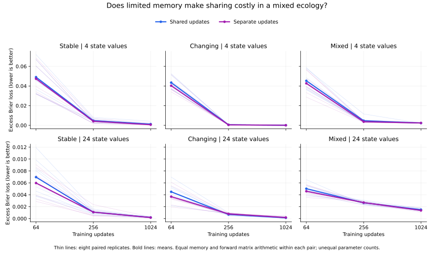

# Memory × ecology: completed exploratory results

All 96 models completed successfully across eight paired replicates. API cost: **$0**. The prespecified primary interaction was inconclusive.

Separate update weights reduced mean error on the prespecified learning-curve measure in all six conditions, by 5.2–12.3% relative to the shared model. However, their advantage also appeared in the homogeneous settings. This run does not show that mixing different temporal problems specifically makes shared update weights costly under limited memory.

## Primary result

Let P(ecology, width) be shared minus separate error. Let D(width) be P in the mixed ecology minus the average P in the two homogeneous ecologies. The primary contrast was D(small memory) − D(larger memory).

- D with four total state values: **+0.0001778**, exploratory paired bootstrap 95% interval **[−0.0004958, +0.0007694]**.
- D with 24 total state values: **−0.0001023**, interval **[−0.0004049, +0.0002052]**.
- **Primary interaction: +0.0002801**, interval **[−0.0003871, +0.0009664]**.

The primary interval spans zero. Five of eight complete replicate contrasts were positive. This is unresolved evidence about the proposed interaction, not evidence that its true value is exactly zero. No favorable individual cell or checkpoint replaces that result.

## Every condition on the prespecified measure

Error is expected excess Brier loss relative to the exact observable-history Bayesian reference, averaged equally at training updates 64, 256 and 1024. Lower is better. Differences are shared minus separate; positive values favor separate weights.

| Ecology | Total state values | Shared error | Separate error | Difference |
|---|---:|---:|---:|---:|
| stable | 4 | 0.0183351 | 0.0173747 | 0.0009604 |
| stable | 24 | 0.0027437 | 0.0024052 | 0.0003385 |
| changing | 4 | 0.0146780 | 0.0136091 | 0.0010689 |
| changing | 24 | 0.0017697 | 0.0015539 | 0.0002158 |
| mixed | 4 | 0.0174386 | 0.0162461 | 0.0011925 |
| mixed | 24 | 0.0030536 | 0.0028787 | 0.0001749 |

Secondary cell intervals are available in summary.json and were not multiplicity-corrected. The separate-model advantage in the small-memory mixed cell occurred in all eight replicates, but that fact alone does not establish an ecology-specific benefit; the homogeneous controls are essential.

Thin lines show individual replicates; bold lines are means. Y scales are shared within each row and differ between memory budgets. Larger memory generally improved the prespecified average by helping early learning. The primary score is not a claim of final convergence.

## Final checkpoints are a secondary result

| Condition | Shared final error | Separate final error |
|---|---:|---:|
| stable-h2 | 0.0012575 | 0.0006623 |
| stable-h12 | 0.0001896 | 0.0001743 |
| changing-h2 | 0.0000864 | 0.0000822 |
| changing-h12 | 0.0001231 | 0.0001876 |
| mixed-h2 | 0.0023225 | 0.0023834 |
| mixed-h12 | 0.0014960 | 0.0013649 |

At the final checkpoint, the shared model had slightly lower mean error in the small-memory mixed ecology and in the larger-memory changing ecology. Thus the across-checkpoint advantage for separate weights does not mean that they won every final comparison. Longer-history, symbol-inversion and family-specific results are preserved in the full records; these are secondary and did not select the headline.

## What changed in our assessment

This test supports a modest predictive benefit of untying recurrent weights on the selected learning-curve measure at equal recurrent state and forward matrix arithmetic. It does **not** establish the proposed ecology-by-memory specialization effect.

The previous pilot's shared model had more state and active arithmetic. In this controlled follow-up both learners received the same state and forward arithmetic at each width. They also began with matched predictions and identical data. Separate models had more trainable parameters: 100 versus 58 at small memory, and 1300 versus 688 at larger memory. Generic representational capacity and optimization remain plausible explanations for their advantage.

The comparison with the preceding pilot is not a clean causal attribution to memory alone: this follow-up also standardized bank identity inputs, made both learners' two readouts independent, and matched their initial recurrent functions. Those changes are controlled within this experiment but differ from the preceding design.

The shared updater remains contextual and can implement different effective computations. Neither a shared-weight win nor a separate-weight win establishes presence or absence of functional specialization. These are two binary temporal-inference problems, not a host of different knowledge domains. No independent mechanism-recovery claim or evolutionary-selection claim is made.

The next substantive hypothesis should specify **which evidence should update which persistent estimate, and how that update should transfer to new situations**. An unable-versus-unwilling task with controlled misleading cues and out-of-distribution cue combinations would connect the learning-rule question to the functional theory. Any future environment and predicted failures should be specified before results, with a strong shared contextual rival retained. This completed follow-up should remain in the record regardless of later outcomes.

## Integrity and reproducibility

- Study: [GitHub Actions run 41015526973](https://github.com/msblanders/wtr-bench/actions/runs/41015526973); all eight training jobs and aggregation succeeded on the first study attempt.
- Frozen source/protocol commit: `ac90fbcf9acb7b1351eb3eb2f5aaf2f9dedebb9e`.
- Launch commit: `060f2a8f0b608eb5a4edf158cbe34a43c1ece68d`.
- Config SHA-256: `8ef8a88068ea4375d620568312bfe1b46aacc8a31f45ed1cf821ce970a3de0fa`.
- Eight development tests passed before study training. Repository lint, type checks, tests and synthetic pilot passed.
- A prelaunch dictionary-iteration lint issue was corrected before the frozen study launch; no training outcome informed that correction.
- All four learners within each ecology/replicate had identical training-stream hashes. Evaluation streams were generated after the replicate's twelve models completed training.
- Full per-replicate records were recovered from completed job logs, checked for all six conditions and eight replicates, and their cell means independently recomputed against the frozen aggregate.
- Inference uses eight complete training replicates, with 10,000 paired bootstrap draws. Observation counts were not treated as independent replications.
- Protocol, config, source hashes, seeds, dependency versions, checkpoint scores, training logs, data hashes and every replicate contrast are preserved here.
- Checkpoint weights are in the eight seed artifacts; artifact IDs/digests and their January 28, 2027 expiry are recorded in artifacts.json. Source and numeric results in this directory are durable repository files.
- Plotting is a post-run presentation step. It did not change scoring, checkpoints, contrasts, or the protocol.

See [the prospectively frozen protocol](../../README.md), [summary.json](summary.json), [replicate-results.json](replicate-results.json), [manifest.json](manifest.json), and [artifacts.json](artifacts.json).
