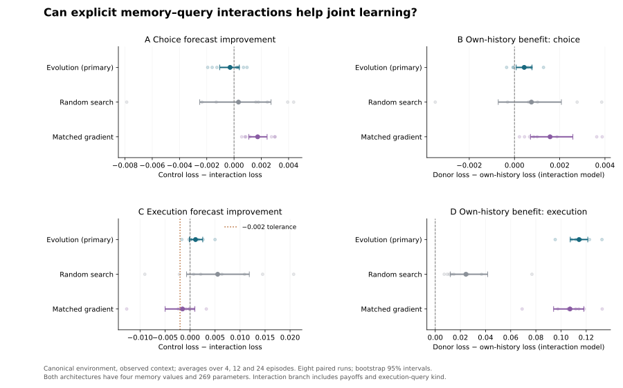

# Memory–payoff readouts: completed pilot

**The evolved interaction learner did not outperform the parameter-matched control on choice prediction. The four-part primary criterion failed.** It did acquire a small useful target-specific choice-history effect and retained strong execution learning; execution met the prespecified noninferiority tolerance. Three of four individual requirements passed. This is partial acquisition evidence, not success of the full comparative hypothesis.

Under matched gradient training, the interaction readout produced clearer preference learning and better choice predictions. Its execution difference was too uncertain to establish the same noninferiority tolerance. The externally generated games favored the gradient-trained interaction model, but these are secondary results on a benchmark inspected in earlier iterations.

All eight paired runs completed on their first attempt: 48 procedures, both objectives retained, four memory values and 269 parameters per model. No API calls or credit use. Mean training plus evaluation time was 43.48 seconds per replicate, excluding runner setup.

## Prespecified primary decision

Canonical habitat mixture, new targets, observed query context, final development-selected checkpoint, equally averaged over 4, 12 and 24 history episodes. Differences and 95% intervals below use eight whole paired runs, not individual targets. Positive differences favor the interaction learner; the execution tolerance permits at most 0.002 additional Brier.

| Requirement | Mean difference [paired bootstrap 95% CI] | Rule for lower bound | Pass? |
|---|---|---:|---|
| Better choice forecast | -0.000293 [-0.001055, +0.000386] | > +0.000 | No |
| Own-history benefit: choice | +0.000429 [+0.000077, +0.000776] | > +0.000 | Yes |
| Own-history benefit: execution | +0.114345 [+0.107339, +0.121271] | > +0.000 | Yes |
| Execution noninferiority | +0.001089 [-0.000149, +0.002535] | > -0.002 | Yes |

The choice-history benefit is small: +0.000429 Brier, positive in five of eight individual run estimates. Execution-history benefit is much larger (+0.114345), positive in all eight. The interaction architecture’s mean choice error is slightly worse than the control (0.229924 versus 0.229631), with an interval compatible with either direction. Its joint choice/execution Brier advantage is also uncertain: +0.000398 [-0.000291, +0.001195]. Do not describe the failed superiority criterion as demonstrated equivalence.

## Final prediction scores

Each value averages the three primary history lengths and eight independent runs. Lower is better. All architectures use joint training and joint development selection; external games have no execution outcomes.

| Suite | Method | Control choice | Interaction choice | Control execution | Interaction execution |
|---|---|---:|---:|---:|---:|
| canonical_seen | Evolution | 0.229631 | 0.229924 | 0.196119 | 0.195030 |
| canonical_seen | Random search | 0.240291 | 0.239965 | 0.245972 | 0.240451 |
| canonical_seen | Matched gradient | 0.230144 | 0.228413 | 0.194762 | 0.196269 |
| canonical_heldout | Evolution | 0.229768 | 0.230108 | 0.195766 | 0.194912 |
| canonical_heldout | Random search | 0.239988 | 0.239904 | 0.246022 | 0.240696 |
| canonical_heldout | Matched gradient | 0.229931 | 0.228207 | 0.194552 | 0.195850 |
| shifted | Evolution | 0.217945 | 0.222676 | 0.203608 | 0.201561 |
| shifted | Random search | 0.254285 | 0.252697 | 0.247841 | 0.244339 |
| shifted | Matched gradient | 0.220274 | 0.220351 | 0.200145 | 0.202931 |
| external_games | Evolution | 0.323112 | 0.323596 | — | — |
| external_games | Random search | 0.333886 | 0.332270 | — | — |
| external_games | Matched gradient | 0.320558 | 0.309775 | — | — |

## What the controls tell us

**Evolution:** On the primary suite, the interaction model’s own-history choice advantage exceeded the control’s donor-history advantage by +0.000583 [+0.000310, +0.000880] (secondary). The control itself had no clear useful choice-history effect: -0.000154 [-0.000560, +0.000262]. Thus the new readout changes acquisition of target-specific information, but that did not translate into better overall choice calibration at this budget.

**Gradient training:** The interaction model lowered canonical choice Brier by +0.001731 [+0.001077, +0.002425], with favorable estimates in all eight runs. Its own-history choice benefit was +0.001573 [+0.000707, +0.002582]. This demonstrates a useful solution within the same 269-parameter model class under this optimizer. Execution control-minus-interaction was -0.001508 [-0.004991, +0.000957]; its lower bound is below −0.002, so the execution penalty is not bounded within the chosen tolerance. Strong execution-history benefit still remains. These are different claims: learning execution is not the same as matching the control’s execution accuracy.

**Branch ablation:** Removing the additional branch without retraining increased canonical choice loss by +0.002218 [+0.001203, +0.003257] for evolution and +0.003143 [+0.002027, +0.004416] for gradient training. These descriptive interventions show reliance on the branch, not a particular internal causal variable; disabling it can be off-distribution.

**Random search:** Both random-search controls remained substantially less accurate overall than their evolved counterparts. Full estimates, including every donor and branch-ablation contrast, are retained in `summary.json`; no favorable random seed is selected as the reported result.

## Generalization: secondary and mixed

- In a previously absent context, the evolved choice superiority and donor-history effects remained uncertain. Gradient choice superiority and donor benefit remained positive.
- Under shifted payoffs/assignment rates, evolutionary choice prediction worsened with the interaction readout: control-minus-interaction -0.004730 [-0.009307, -0.001167]. Its donor-history choice benefit was uncertain. This is an adverse transfer result, not evidence of robust generalization.
- In the independent upstream games, evolutionary superiority and donor benefit were both uncertain. Matched gradient training lowered choice Brier from 0.320558 to 0.309775: +0.010783 [+0.004468, +0.016630], a 3.36% relative reduction. Its own-history benefit was +0.014986 [+0.008150, +0.022652]. These games were inspected during earlier study iterations, so this is secondary iterative-development evidence, not a fresh confirmatory external validation.

## Evidence-update diagnostics

The following are descriptive mean choice-probability changes in the observed-context diagnostic. They are not the primary inferential test. The supplied reference knows the generative family and sees full menus.

| Procedure | Voluntary failure versus refusal | Refusal versus unchanged |
|---|---:|---:|
| wide_control / Evolution | +0.000727 | -0.000273 |
| wide_control / Matched gradient | +0.005318 | -0.003401 |
| interaction / Evolution | +0.003879 | -0.003613 |
| interaction / Matched gradient | +0.019563 | -0.014368 |
| Supplied reference | +0.115460 | -0.070116 |

Interaction learners moved choice predictions in the intended direction on these contrasts, but far less than the supplied reference. Success-versus-failure and assigned-outcome events also affected choice when the reference predicts zero change. The evolved interaction learner’s assigned-success versus assigned-failure choice shift was +0.002338, alongside a +0.156688 execution shift. This is not clean cue selectivity or a recovered willingness/ability decomposition. `secondary-analysis.json` retains all five contrasts in both output channels, raw-final 24-episode means, and initial scores. Full per-run records retain seen and held-out diagnostics. Raw-final means are descriptive; do not attach the primary intervals to them.

## Interpretation and next discriminating question

The result supports a narrow engineering observation: making memory–query products available helps acquire preference-relevant history use, especially under gradient training. Evolution also found a small useful choice update while retaining execution learning, but the readout change did not produce a reliable choice-accuracy advantage and worsened shifted-payoff performance. The current evolutionary search remains weaker at exploiting this representation; that is a result at this fixed budget, not evidence that evolution cannot find the solution.

The added branch includes eight memory–payoff coefficients and four memory–execution-kind coefficients. This package comparison cannot isolate multiplication of payoffs alone. Equal parameter counts do not equalize computation or function-space initialization. We supplied the interaction operation and both candidate architectures; selection did not discover their structure. No abstract IRV, single causal variable, evolved modular architecture or broad multi-domain principle has been identified.

A useful next question is whether a prospectively fixed evolutionary-budget sweep strengthens preference updating and improves held-out prediction, with this world, objective and parameter-matched comparison unchanged. It should retain the negative shifted-payoff result and the execution bound, rather than tune until only one benchmark improves. No additional study was launched after these outcomes.

## Reproducibility and preservation

- [Frozen protocol/source commit](https://github.com/msblanders/wtr-bench/tree/795a6e7c3dfe5b973ed3674e1115467e88916d2e/experiments/memory-payoff-v1). Training source and protocol were not edited after launch.
- [Completed Actions run 41116410378](https://github.com/msblanders/wtr-bench/actions/runs/41116410378), launch commit `720bfc01c5976ad1ec9417c12d0cb03962d3f879`, attempt 1. All eight study jobs and aggregation succeeded.
- Eight dedicated integrity tests passed before selection. Repository lint, type checks, tests and synthetic smoke test passed before launch. No failed study attempt or outcome-dependent rerun.
- `results-index.json` lists all eight replicate records and all 48 final model parameter sets. `run-info.json`, `manifest.json` and `artifacts.json` record execution status, configuration/source/runtime hashes and artifact identifiers. Configuration SHA-256: `7af3a8c05ce9c7057000bb91a4996a66e6ee0e05ccd6985e2aac2a0424137a79`.
- Independent NumPy analysis reproduced all 240 paired contrasts and bootstrap intervals to absolute tolerance 1e-14, checked data pairing and source hashes, and verified all 48 parameter vectors are finite and length 269. Saved-model reconstruction was covered by the prelaunch tests. `verification.json` records the checks; `../../analyze_saved.py` reproduces verification and the figure. In the standalone bundle, run `python analyze_saved.py .` from the extracted folder.
- Final selected parameters and metrics are retained with this report. Additional checkpoint artifacts expire January 28, 2027 (Pacific); their identifiers and digests are saved. Upstream source remains pinned and checksum-verified; it is not republished here.
- This remains a draft research branch. No merge, API call, or additional experiment was performed.

## Publication status

Publication initially paused after automatic approval review required authorization specifically covering this follow-up. On October 30, 2026, the user explicitly authorized publication of these results and parameters to `msblanders/wtr-bench`, and the same artifacts for future WTR-Bench tests they explicitly authorize. All eight runs and all 48 selected models are preserved here. The earlier private bundle remains a historical pre-publication snapshot. No study was repeated for publication.
