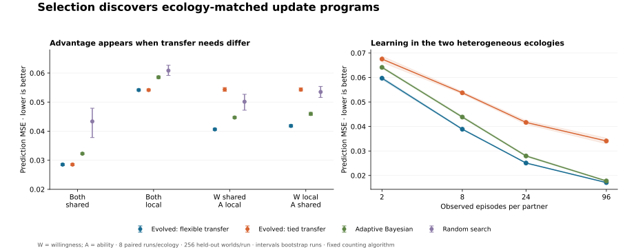

# Rule-selection pilot: completed results

**Selection recovered the theory-reference evidence-routing and sharing programs in all 32 run/ecology combinations.** It started from random programs, with no correct program seeded deliberately.

When willingness and ability had different sharing structures, independent transfer rules reduced held-out prediction MSE by **24.1%** relative to forcing both estimates to use the same transfer rule. In the two homogeneous ecologies, the selected flexible and tied programs made identical predictions.

Eight paired evolutionary runs per ecology; 64 selection worlds and 256 new evaluation worlds per run. Each search evaluated 2,560 candidate genotypes. Predictions below average the prespecified 2, 8 and 24 exposure checkpoints; lower error is better.

| Ecology | Evolved flexible | Evolved tied | Random search | Adaptive Bayesian |
|---|---:|---:|---:|---:|
| Both quantities shared | 0.02853 | 0.02853 | 0.04336 | 0.03226 |
| Both quantities local | 0.05415 | 0.05415 | 0.06084 | 0.05854 |
| Willingness shared; ability local | 0.04063 | 0.05433 | 0.05013 | 0.04470 |
| Willingness local; ability shared | 0.04182 | 0.05429 | 0.05350 | 0.04593 |

## Prespecified interaction and intervention

The tied-minus-flexible advantage was 0.01309 MSE larger in heterogeneous than homogeneous ecologies (paired run bootstrap 95% interval 0.01265–0.01359; eight run-level differences). This is an exploratory synthetic-model interval, not evidence about humans or LLM populations.

Swapping only the two evolved transfer bits raised heterogeneous-ecology error from 0.04122 to 0.06818. Swapping them had no effect in homogeneous ecologies, where the bits were identical. Complete program swaps also harmed performance, but additionally corrupt the evidence gates and are less specific.

## What selection discovered

| Event | Willingness update | Ability update |
|---|---|---|
| Voluntary decline | Negative evidence | Ignore |
| Voluntary failed attempt | Positive evidence | Negative evidence |
| Voluntary successful attempt | Positive evidence | Positive evidence |
| Assigned failed attempt | Ignore | Negative evidence |
| Assigned successful attempt | Ignore | Positive evidence |

Both evolutionary conditions attained the exact best selection-set score within their respective finite classes in every run. Equal-budget random search recovered the exact reference genotype in 1/32 combinations. Because this class factorizes, exact enumeration also solves it cheaply; this is no claim that evolution is the best optimizer.

## Interpretation

This is a proof of principle that selection can recover problem-appropriate evidence gates and conditional transfer from a specified program space, with an interpretable ecological boundary. It extends the earlier supplied-memory pilot by actually searching for the programs.

A single shared contextual interpreter reproduced every evolved prediction exactly. The result therefore does not identify separate physical modules or establish a need for genuinely different mathematical learning rules. All agents use the same supplied event categories, two estimates, and Beta-counting algorithm; the flexible class has one extra independent bit. This remains one social domain. Specialization across qualitatively different computations is still untested.

The evolved programs also outperformed the Bayesian baseline at these early checkpoints, but they had prior selection across many worlds from a stable ecology. The Bayesian comparator inferred sharing within each new world. This informational difference prevents a claim of superiority to an equally meta-trained shared learner. No maintenance cost was imposed, so identical transfer behavior in homogeneous ecologies does not demonstrate loss of redundant machinery.

## Reproducibility

Source and protocol were committed before selection: [13213d99de2c1236047d33a5de490af00d5ad3ac](https://github.com/msblanders/wtr-bench/tree/13213d99de2c1236047d33a5de490af00d5ad3ac/experiments/rule-selection-v1). The manifest preserves source hashes, NumPy version, configuration, and every selection/evaluation seed. `selection-runs.json` contains all selected genotypes, generation traces, optimization gaps, and holdout metrics; `summary.json` contains the paired contrasts. Worlds are deterministic from the frozen generator and seeds. No API responses or private user material are included.

Full experiment elapsed time on this host: 25.09 seconds; **API cost: $0**. Timing includes world generation, finite-class fitness compilation, all searches, evaluation, and run-record writes. Seven scientific/integration tests and dedicated CI passed. The counts and finite-class fitness cache are part of the implementation; no neural FLOP-efficiency claim is made.

To rerun, check out the frozen commit, install its pinned requirements, and follow the three commands in its README. The figure is generated afterward by `analyze.py` using NumPy and Matplotlib; it does not affect selection or scoring.
