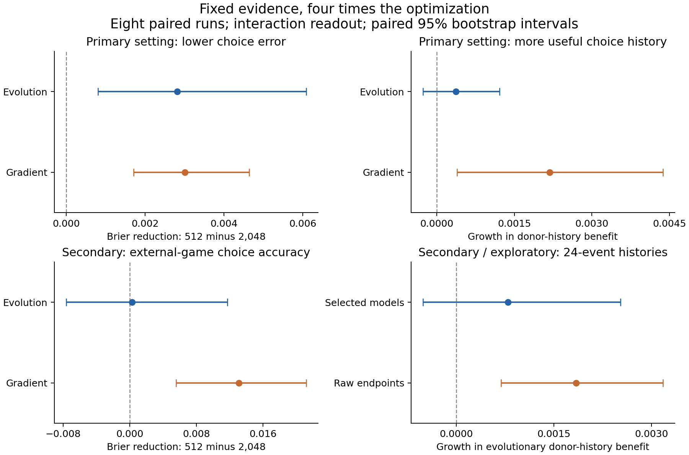

# More optimization improves prediction, but the primary learning-growth test fails

Completed fixed-evidence optimization pilot, October 30, 2026. Eight paired independent runs,
48 training trajectories, 96 budget-selected models. **Four of five primary requirements
passed; the conjunction failed.** No model API calls or API credit were used. GitHub Actions
compute was used; no claim is made here about that platform's billing.

## What this experiment tested

Each learner received the same bank of 32,768 observed lifetimes for either 512 updates
(one pass) or 2,048 updates (four passes). Both choice and execution prediction remained in
the training objective. We retained the interaction and parameter-matched control readouts,
each with 269 parameters and four memory values, and evolutionary, random-search and
matched-gradient optimization. No model was retrained for this publication.

The short budget selected a model from steps 1–512; the long budget selected from every fourth
step through 2,048. Each also considered the initial model: 513 development opportunities each.
The pools are different, and the long pool is not a superset. More optimization therefore
also means more presentations and candidate evaluations, while distinct evidence and the
number of development choices remain fixed. It is not an equal-compute comparison.

The primary evaluation averages choice/execution Brier scores equally over histories of
4, 12 and 24 events in the canonical, previously observed query context. Eight complete
training runs are the independent units. All intervals below use the fixed 10,000-resample
paired whole-run bootstrap. Small-sample bootstrap intervals should not be treated as broad
generalization guarantees.

## Primary result

For the evolved interaction readout, choice Brier fell from **0.229914 to 0.227102**,
a **1.22%** reduction in the mean score. Seven runs improved and one was unchanged; none
worsened. The unchanged run selected the same step-264 model under both budgets.
Execution prediction also improved on average.

The long-budget model used the target's own history beneficially for both outcomes.
However, the increase in its useful choice-history dependence relative to the short-budget
model remained uncertain. That additional growth requirement is why the full criterion failed.
There is evidence of target-specific choice learning at 2,048; there is not clear primary
evidence that the extra optimization strengthened it.

| Prespecified requirement | Mean contrast [95% interval] | Required lower bound | Result |
|---|---:|---:|---|
| Choice prediction improves | +0.002812 [+0.000808, +0.006082] | > +0.000 | Pass |
| Choice donor-history benefit grows | +0.000368 [-0.000269, +0.001214] | > +0.000 | Fail |
| Long-budget choice donor benefit is positive | +0.001374 [+0.000166, +0.002658] | > +0.000 | Pass |
| Long-budget execution donor benefit is positive | +0.120776 [+0.113825, +0.126808] | > +0.000 | Pass |
| Execution is noninferior (margin 0.002) | +0.001981 [+0.000380, +0.003522] | > -0.002 | Pass |

For accuracy contrasts, positive means lower error after more optimization. A donor-history
benefit is donor-history error minus own-history error, with the query and target fixed.
Its growth is the long-budget benefit minus the short-budget benefit. A positive donor
benefit measures useful history dependence; it does not identify a shared abstract IRV.

## Secondary findings

- **Gradient optimization:** With the interaction readout, canonical choice error fell 1.32%.
  Choice donor-benefit growth was +0.002179 [+0.000389, +0.004373].
  External-game choice error fell from 0.315307 to 0.302202 (**4.16%**); its absolute reduction
  was +0.013105 [+0.005564, +0.021174].
- **Evolutionary external transfer:** External choice error changed only 0.09% on average;
  the reduction was +0.000276 [-0.007622, +0.011716].
  Thus improved canonical performance did not establish improved external accuracy.
- **Shifted payoffs:** Evolved interaction choice error fell 2.66%, with an absolute reduction
  of +0.006007 [+0.001574, +0.011979]. This is improvement over its own short
  budget, not evidence that it beats the control architecture under shifted conditions.
- **Architecture superiority remains unestablished:** At 2,048, the canonical control-minus-
  interaction choice contrast was +0.000341 [-0.000625, +0.001244].
  The inherited architecture-superiority conjunction failed at both budgets. The new study's
  positive budget effect must not be described as a positive architecture-superiority result.

External games were inspected in preceding studies and remain secondary iterative development.
They do not provide execution outcomes. No correction or confirmation claim is attached to
the many secondary intervals; the complete 570 contrasts are retained in `summary.json`.

## A useful checkpoint-selection lead

The protocol also saved unselected raw models at steps 512 and 2,048. At the prespecified
24-event observed-context diagnostic, the evolved interaction model's choice-history benefit
grew by **+0.001840 [+0.000690, +0.003174]** when comparing those raw stopping points. This secondary result
differs from the primary result, which used development-selected models and averaged three
history lengths.

To avoid attributing that difference solely to checkpoint selection, we also compared the
policies at the same 24-event length. This reporting-stage decomposition is **exploratory**:
growth for selected models was +0.000792 [-0.000511, +0.002525], and raw-minus-selected growth was +0.001048 [+0.000307, +0.001834].
The discrepancy is a concrete reason to investigate checkpoint selection, but does not rescue
the failed primary test or prove that a new selection policy will generalize. It was not used
to replace the selected models or change the original decision rule.

A motivated next test would use fresh seeds to compare development selection rules on fixed
training trajectories, with a prospectively specified choice objective and execution safeguard.
That test needs its own frozen design; no additional training was launched here.

## Verification and provenance

- Original [study run 41124711900](https://github.com/msblanders/wtr-bench/actions/runs/41124711900),
  attempt 1: nine integrity tests, eight training jobs and aggregation all passed.
- Frozen scientific commit: `1ee9405a0f0c3163918ecfbdb14b7fdccc47d3c2`.
  Launch commit: `985f87e07ce53d86df7f0c87d44abd6a264180b5`.
  The original protocol, source and data records have not been edited.
- All ten original ZIPs match the byte counts and SHA-256 digests returned by GitHub.
- All eight seed records equal the copies in the original aggregate. Source/configuration,
  data pairing, parameter counts and development-opportunity metadata agree.
- Independently recomputed **570 paired contrasts and their intervals** from the saved
  per-run cells. Maximum numerical difference from the original summary: 1.11e-16.
- Recovered **all 96 selected models**, each with 269 finite parameters. All 64 evolutionary/
  random-search vectors match the exact budget keys in the original NumPy checkpoints;
  all 32 gradient vectors match stored tensor bytes in the PyTorch archives.
- An independent NumPy forward pass replayed all 96 models on the canonical seen-context
  24-event evaluation slice, under intact, zero-memory, donor-history and branch-disabled
  conditions, scoring both outcomes. Maximum Brier discrepancy: 8.42e-09
  (tolerance fixed in the audit at 1e-6). This is a numerical reconstruction check, not a new
  experiment, independent human review, or a complete original-runtime rerun.

## Files and offline reproduction

- `summary.json`: original full summary, all 570 contrasts, checkpoint ages and decisions.
- `manifest.json`: original runtime, seeds, configuration and source hashes.
- `models/seed-0.json` through `models/seed-7.json`: all 96 selected parameter vectors in
  portable JSON. Keys are budget → readout → optimization method → `theta`.
- `archives/`: unchanged frozen-source, aggregate and eight per-seed ZIPs. Per-seed archives
  include selected and raw checkpoints; the aggregate includes all per-run metrics, all
  history lengths, evidence diagnostics, ablations and paired data identifiers.
- `audit_results.py` and `audit.json`: independent reporting-stage verification and the
  labeled secondary/exploratory decomposition. `provenance.json` identifies every archive.
- `original-aggregate-report.md`: unchanged report emitted by the study workflow.

With Python and NumPy available, run from this results folder:

```bash
python audit_results.py .
```

This verifies and extracts the archives to a temporary directory, checks the stored results,
and writes `audit-recomputed.json`. It does not download anything, train, call an API,
deserialize a pickle, or overwrite the original audit. The audit was run with NumPy 2.3.5;
the original training manifest records Python 3.11.17, NumPy 1.26.4 and PyTorch 2.5.1+cpu.



Reports, code and checks were prepared with AI assistance. Publication is covered by the
user's standing authorization in `experiments/PUBLICATION_AUTHORIZATION.md`.
PR #20 remains a draft; publication does not imply merge or confirmatory success.
